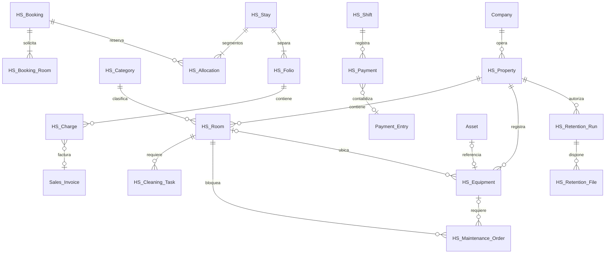
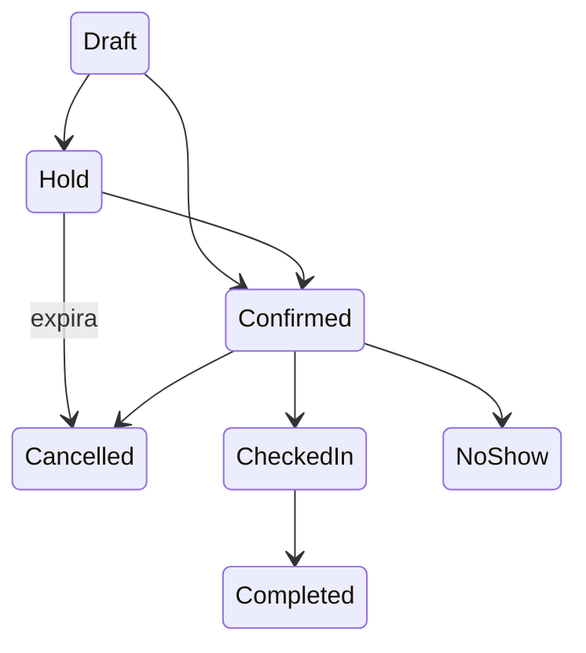

# Decisiones y modelo

HS Service Account es una tabla hija de HS Property para clasificar cada Item por ingreso, gasto y centro de costo. Se aplican valores de la sede y después los nativos; no se modifican Item Default compartidos. La validación de documentos estándar aplica la clasificación antes de contabilizar, conserva cuentas de inventario en compras y omite devoluciones/documentos ya presentados para preservar la historia. Configuración y permiso contable se validan en el servidor. Véase AUDITORIA_CONTABILIDAD_SERVICIOS.md.

Objetivo instalado: Frappe 16.52.0 (`4515014`) y ERPNext 16.51.1 (`5af6561`). Frontend: Page API, controles y diálogos nativos de Frappe, JavaScript y CSS propios sin framework adicional; facilita mantenimiento y compilación en el bench existente. No se modifica el núcleo.

Prefijo propio `HS`. Los recursos consultados, sujetos a permisos, bloqueos o ciclos de vida independientes son DocTypes. Habitaciones solicitadas de una reserva y acompañantes son tablas hijas. Los cargos son documentos independientes para permitir separación de folios y trazabilidad hasta una línea de factura.

HS Equipment registra identificación/ubicación/instrucciones operativas y un vínculo opcional con Asset estándar. No duplica valoración ni depreciación. Un activo corresponde a un solo equipo y debe estar asignado a su compañía/establecimiento. Una orden puede pertenecer a una habitación o equipo; solo crea HS Allocation si bloquea una habitación. Las órdenes de un mismo equipo no se solapan. La vista de mantenimiento recibe datos mínimos del equipo; los valores contables de Asset requieren roles y alcance propios.

La compañía procede siempre del establecimiento. Un bloqueo `SELECT ... FOR UPDATE` sobre el establecimiento serializa cambios de cupo, incluso cuando todavía no existen asignaciones. Se prefieren bloqueos gruesos seguros antes de optimizaciones prematuras. Orden de bloqueos: establecimiento, operación, documentos secundarios. Intervalos `[inicio, fin)` y colchón de limpieza separado. Una asignación cuenta una sola vez, tanto con habitación como sin ella. La reserva se convierte en estancia sustituyendo la asignación dentro de la misma transacción.

Fechas guardadas en la zona del sistema Frappe; conversión explícita desde/hacia la zona del establecimiento. Los cálculos de duración usan instantes con zona y los límites de días usan la zona local del establecimiento. Fecha operativa independiente; fecha contable explícita según documentos ERPNext.

Las peticiones de escritura exigen idempotencia, se vinculan al usuario, acción y carga canónica y se registran en la misma transacción. No hay commits intermedios en servicios. Los cambios operativos solamente se permiten mediante el servicio; los formularios/API genéricos no pueden saltar disponibilidad, permisos o caja. Cualquier fallo hace rollback en el límite HTTP de Frappe.

La retención revisada usa HS Retention Run y su tabla hija HS Retention File. La aprobación y el retiro de campos, versiones y metadatos File pertenecen a una transacción; un mixin nativo aplaza únicamente la eliminación física durante esa operación. El outbox persistido se procesa después del commit mediante RQ como servicio del sistema. La aprobación conserva su usuario original. Un rollback no elimina bytes; un reintento puede completar una eliminación física interrumpida. Las referencias de contenido compartido se conservan y las rutas del outbox se limpian al terminar.

Ingresos y existencias: exclusivamente Sales Invoice, Payment Entry, Journal Entry y Stock Entry estándar. Un cargo pendiente es operativo; reconoce ingreso al presentar factura. El inventario de consumos se entrega mediante Stock Entry, nunca también mediante `update_stock` de la factura. Las garantías utilizan una cuenta de pasivo configurada y un documento estándar separado.

Ocupación, limpieza y mantenimiento son dimensiones independientes. Salida → sucia → en limpieza → inspección opcional → limpia. Ningún estado de reserva futura convierte una habitación en ocupada actualmente.

Referencias contrastadas con el código instalado: [Page API](https://docs.frappe.io/framework/user/en/api/page), [transacciones](https://docs.frappe.io/framework/user/en/api/database), [anticipos ERPNext](https://docs.frappe.io/erpnext/advance-payment-entry).

## Bloqueo sin vencimiento — 0.7.1

HS Maintenance Order.until_reopened permite ends_at vacío. HS Allocation admite fin vacío únicamente para mantenimiento respaldado por esa política; el controlador exige fin en reservas/estancias. Las consultas proyectan el bloqueo al horizonte solicitado y la creación contrasta todas las obligaciones futuras. No se guardan fechas centinela ni se cambia HS Room.active. Completar con supervisión libera la asignación; calendario/indicadores recortan el historial en el evento de finalización. Los intervalos existentes conservan fechas, política y registros, acreditados en housekeeping-audit-upgrade.json.

## Contexto de operación y entradas — 0.7.2

service.command fija (establecimiento, compañía) durante operation; api.preview usa el mismo contexto sin marcar una escritura. security valida referencias antes de leer y después de cargar; locked_doc y ScopedDocument aplican ese alcance a documentos HS, y validate_standard al origen contable. Las operaciones anidadas no pueden cambiar de establecimiento y el contexto se restaura en finally. Los permisos de rol/lectura permanecen separados y obligatorios. No se restringen artificialmente maestros compartidos de compañía ni candidatos internos de conciliación.

inputs.object_payload limita tamaño/profundidad y rechaza JSON inválido/no finito también cuando Frappe ya lo decodificó. Portal conserva los límites nativos por IP, POST y enlaces firmados acotados. AUDITORIA_SEGURIDAD.md delimita 319 pruebas nativas, 19 controles HTTP y el alcance de la revisión estática; no sustituye la recuperación final ni el contraste posterior de bitácoras de 0.7.3.

## Valores históricos y ejecuciones — 0.7.3

audit_trail.FIELDS define proyecciones explícitas dentro de details._values, versión 1, con before/after; no replica identidad, contactos, archivos ni payloads externos. HS Rate exige motivo de edición y registra cambios desde su controlador aun sin Version. Las claves previas de los eventos nativos permanecen disponibles. audit_detail valida rol, lectura documental, compañía y establecimiento y solo presenta campos permitidos con etiquetas; los registros anteriores no se reconstruyen con datos actuales.

El cierre captura excepciones por fecha operativa del evento, resumen/bloqueos y presentación. Cada evento conserva el snapshot de su propia ejecución; el documento diario muestra la última. Confirmar registra el día original aunque el establecimiento ya avance. El impreso nuevo conserva nombre, zona, hora y observación. service.command mantiene bloqueo, transacción, clave y resultado: dos fallos inyectados acreditan rollback y recuperación desde la última operación completa. Detalles y límites en BITACORA_Y_CIERRES.md.

## Consumos y consultas por ubicación — 0.7.4

La devolución pendiente revierte el cargo y sus ajustes Pending/Scheduled bajo el bloqueo/transacción existentes. La devolución facturada mantiene la exigencia de nota nativa y la cancelación estándar del Stock Entry, sin escribir GL/SLE manualmente. Una cantidad explícita cero ya no adopta el valor predeterminado uno.

hospitality_inventory.js mantiene una identidad de vista, propiedad, almacén y secuencia por consulta. Las respuestas/errores obsoletos se descartan antes de pintar o cambiar aria-busy. La Page recreada reemplaza la identidad de vista. Los estados tienen texto y reintento; las acciones del servicio se limitan al estado/permiso, conservando versión y clave del comando. Las funciones nativas de ERPNext siguen siendo autoridad para cantidades, valoración, impuestos, POS y compras. HRMS no es dependencia obligatoria; instalado no se supone ni se requiere. Véase AUDITORIA_INVENTARIO_SERVICIOS.md.

## Límite y pendientes del día — 0.7.5

close_checks recoge llegadas/salidas hasta business_window.ends_at exclusivo, incluidas asignaciones Reservation aún activas en reservas Checked In. Vencimiento usa el reloj para clasificar la salida dentro de ese límite; no usa el reloj para redefinir D. Pendientes/noches usan su fecha operativa/de servicio; turnos y diferencias conservan las comprobaciones nativas. Cada grupo conserva documents y añade items/hint/page con descripciones limitadas. close_review guarda etiquetas del período; la huella de aceptación incluye pendientes y presentación estable.

La Page prioriza esos grupos, pagina las descripciones guardadas y solo ofrece rutas conocidas presentes en sus Pages autorizadas. Los vínculos a cuenta/conciliación mantienen establecimiento y permisos. El resumen antiguo sin items no se completa mediante lecturas actuales. time.cutoff_time rechaza explícitamente 24 antes de time.fromisoformat, que Python 3.14 convertiría a medianoche. FECHA_Y_PENDIENTES_CIERRE.md conserva aserciones y límites.

El historial de habitación combina asignaciones, bitácora operativa y Version desde una proyección autorizada de lectura. Recepción no recibe permisos genéricos adicionales sobre las dos últimas fuentes. Las instantáneas conservan referencias originales; los títulos nativos se resuelven solo sin ambigüedad y las fronteras de establecimiento suprimen valores anteriores. Los intervalos históricos conservan salida real/finalización registrada, con períodos abiertos explícitos. Véase HISTORIAL_HABITACIONES.md.
