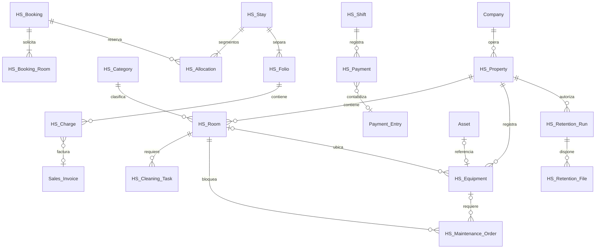
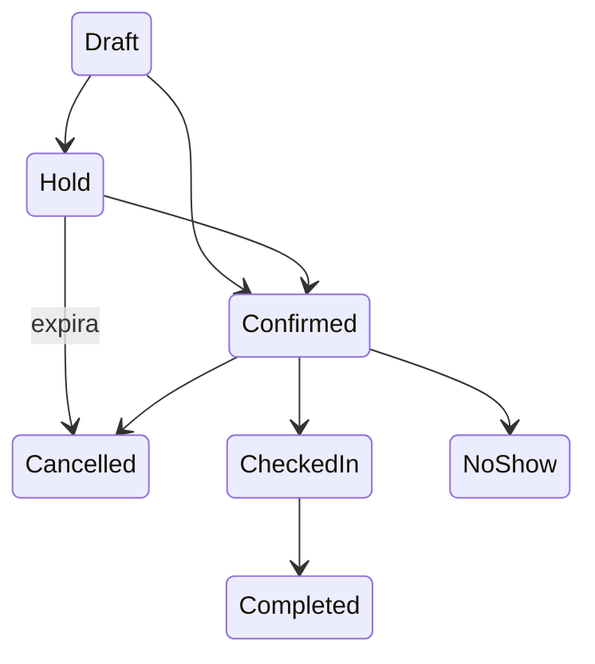

# Decisiones y modelo

HS Service Account es una tabla hija de HS Property para clasificar cada Item por ingreso, gasto y centro de costo. Se aplican valores de la sede y después los nativos; no se modifican Item Default compartidos. La validación de documentos estándar aplica la clasificación antes de contabilizar, conserva cuentas de inventario en compras y omite devoluciones/documentos ya presentados para preservar la historia. Configuración y permiso contable se validan en el servidor. Véase AUDITORIA_CONTABILIDAD_SERVICIOS.md.

Objetivo instalado: Frappe 16.52.0 (`4515014`) y ERPNext 16.51.1 (`5af6561`). Frontend: Page API, controles y diálogos nativos de Frappe, JavaScript y CSS propios sin framework adicional; facilita mantenimiento y compilación en el bench existente. No se modifica el núcleo.

Prefijo propio `HS`. Los recursos consultados, sujetos a permisos, bloqueos o ciclos de vida independientes son DocTypes. Habitaciones solicitadas de una reserva y acompañantes son tablas hijas. Los cargos son documentos independientes para permitir separación de folios y trazabilidad hasta una línea de factura.

HS Equipment registra identificación/ubicación/instrucciones operativas y un vínculo opcional con Asset estándar. No duplica valoración ni depreciación. Un activo corresponde a un solo equipo y debe estar asignado a su compañía/establecimiento. Una orden puede pertenecer a una habitación o equipo; solo crea HS Allocation si bloquea una habitación. Las órdenes de un mismo equipo no se solapan. La vista de mantenimiento recibe datos mínimos del equipo; los valores contables de Asset requieren roles y alcance propios.

La compañía procede siempre del establecimiento. Un bloqueo `SELECT ... FOR UPDATE` sobre el establecimiento serializa cambios de cupo, incluso cuando todavía no existen asignaciones. Se prefieren bloqueos gruesos seguros antes de optimizaciones prematuras. Orden de bloqueos: establecimiento, operación, documentos secundarios. Intervalos `[inicio, fin)` y colchón de limpieza separado. Una asignación cuenta una sola vez, tanto con habitación como sin ella. La reserva se convierte en estancia sustituyendo la asignación dentro de la misma transacción.

Fechas guardadas en la zona del sistema Frappe; conversión explícita desde/hacia la zona del establecimiento. Los cálculos de duración usan instantes con zona y los límites de días usan la zona local del establecimiento. Fecha operativa independiente; fecha contable explícita según documentos ERPNext.

Las peticiones de escritura exigen idempotencia, se vinculan al usuario, acción y carga canónica y se registran en la misma transacción. No hay commits intermedios en servicios. Los cambios operativos solamente se permiten mediante el servicio; los formularios/API genéricos no pueden saltar disponibilidad, permisos o caja. Cualquier fallo hace rollback en el límite HTTP de Frappe.

La retención revisada usa HS Retention Run y su tabla hija HS Retention File. La aprobación y el retiro de campos, versiones y metadatos File pertenecen a una transacción; un mixin nativo aplaza únicamente la eliminación física durante esa operación. El outbox persistido se procesa después del commit mediante RQ como servicio del sistema. La aprobación conserva su usuario original. Un rollback no elimina bytes; un reintento puede completar una eliminación física interrumpida. Las referencias de contenido compartido se conservan y las rutas del outbox se limpian al terminar.

Ingresos y existencias: exclusivamente Sales Invoice, Payment Entry, Journal Entry y Stock Entry estándar. Un cargo pendiente es operativo; reconoce ingreso al presentar factura. El inventario de consumos se entrega mediante Stock Entry, nunca también mediante `update_stock` de la factura. Las garantías utilizan una cuenta de pasivo configurada y un documento estándar separado.

Ocupación, limpieza y mantenimiento son dimensiones independientes. Salida → sucia → en limpieza → inspección opcional → limpia. Ningún estado de reserva futura convierte una habitación en ocupada actualmente.

Referencias contrastadas con el código instalado: [Page API](https://docs.frappe.io/framework/user/en/api/page), [transacciones](https://docs.frappe.io/framework/user/en/api/database), [anticipos ERPNext](https://docs.frappe.io/erpnext/advance-payment-entry).
