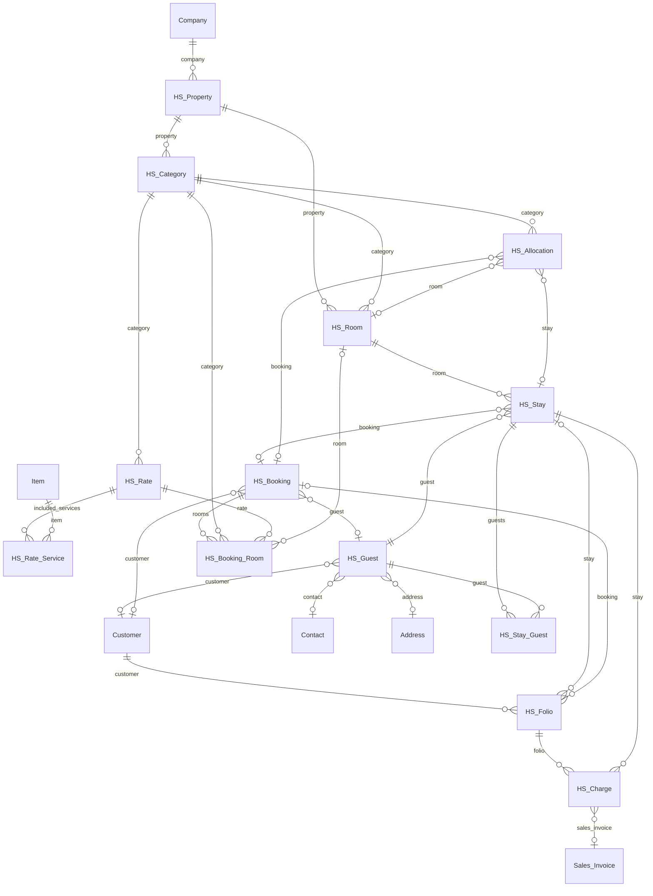
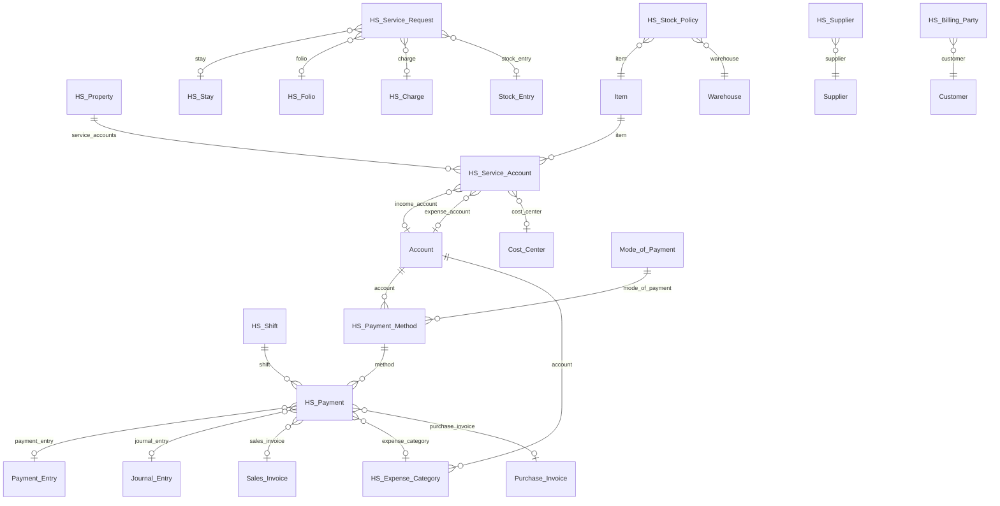
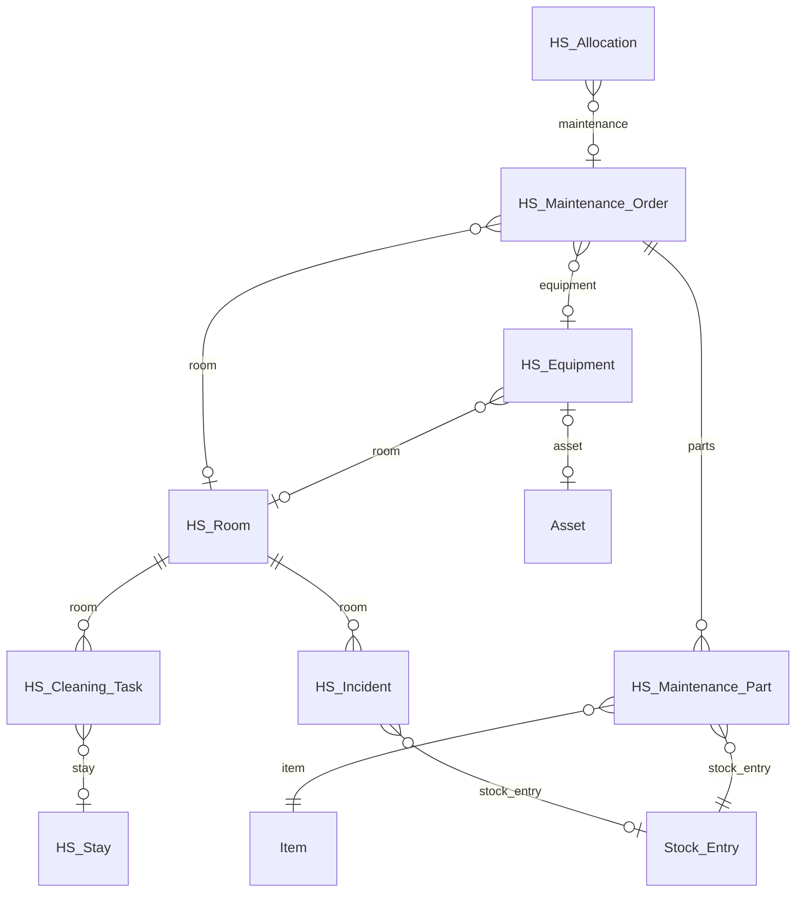
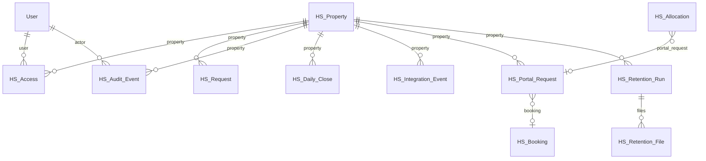
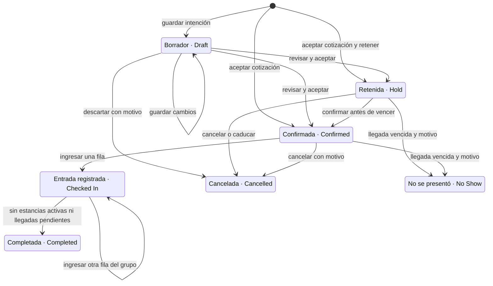
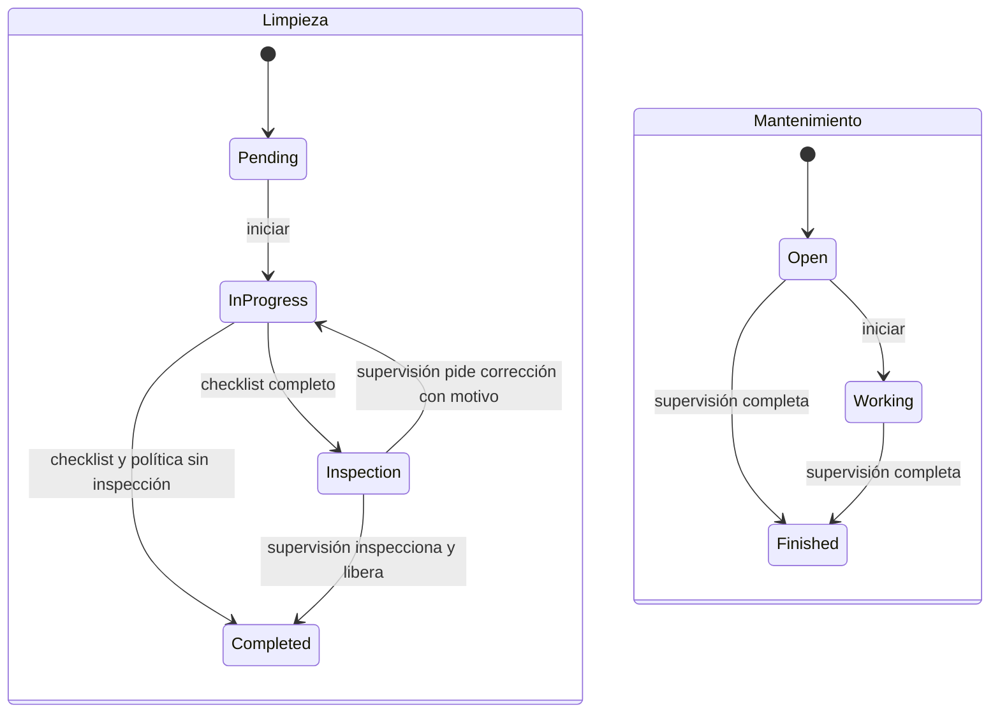
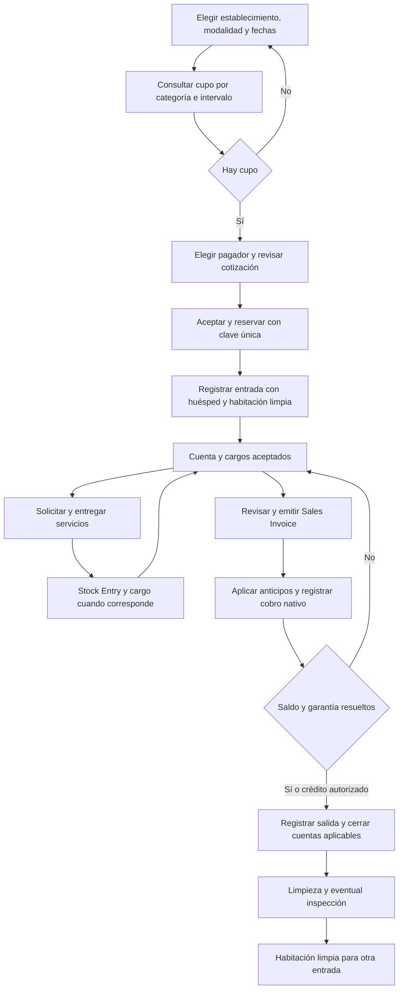
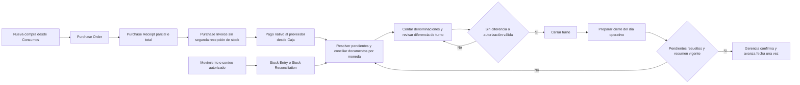

# Modelo, estados y flujos principales

Diagramas de la app sobre Frappe 16.52.0 / ERPNext 16.51.1, contrastados con `schema.py` y los servicios actuales. Los nombres HS de los diagramas corresponden a DocTypes; los espacios se representan con guiones bajos. Las etiquetas de las relaciones son campos reales. En los enlaces opcionales puede faltar el documento de destino. La compañía y el establecimiento delimitan las operaciones mediante permisos y contexto del servidor.

## Reservas, alojamiento y tarifa

El borrador conserva intención sin filas de habitaciones aceptadas ni asignaciones. Confirmar reserva capacidad por categoría, con o sin habitación física. Al ingresar se libera la asignación Reservation de esa fila y se crea la asignación Stay en la misma transacción; otras filas de un grupo pueden seguir pendientes. Un cambio de habitación conserva los segmentos anteriores. Una cuenta grupal puede reunir varias estancias de la reserva.

## Caja, servicios y documentos estándar

Sales Invoice reconoce el ingreso; Payment Entry y Journal Entry registran dinero, anticipos y garantías según su concepto. Los cobros POS nativos ya contabilizados se consultan desde ERPNext y no crean otro HS Payment. Las compras y el inventario utilizan Purchase Order, Purchase Receipt, Purchase Invoice, Stock Entry y Stock Reconciliation estándar. Los libros GL, Payment Ledger y Stock Ledger proceden de sus controladores nativos.

## Limpieza, mantenimiento y equipos

Una orden de equipo puede existir sin habitación; solo bloquea cupo si su política lo solicita. Asset conserva valoración/depreciación nativas. Un bloqueo hasta reapertura tiene fin vacío y se libera al completar con autorización; una fecha prevista vencida tampoco completa la orden por sí sola. La ocupación, la limpieza y el mantenimiento se consultan como dimensiones distintas.

## Acceso, portal y trazabilidad

HS Request conserva idempotencia; HS Audit Event conserva actor, origen y valores permitidos. HS Retention File es el outbox privado de una ejecución de retención: conserva referencias/rutas para el retiro posterior al commit, sin convertirse en otro archivo contable. HS Integration Event registra el receptor técnico. La sincronización con Airbnb/Booking y otros canales sigue aplazada.

## Estados de reserva y tareas

Las etiquetas incluyen el código persistido para que soporte pueda contrastarlo con el servicio; la interfaz operativa usa las etiquetas en español.

En limpieza, InProgress representa In Progress, Inspection representa Inspection y Completed representa Completed. En mantenimiento, Working representa In Progress y Finished representa Completed. Completar mantenimiento libera su asignación; no existe una transición que vuelva a abrir una orden completada. Otra incidencia requiere otra orden. La salida de estancia cambia Active a Checked Out y crea la tarea de limpieza con habitación Dirty; iniciar, inspeccionar y completar actualizan Cleaning, Inspection y Clean conforme a la política.

## Flujo de alojamiento y cuenta

Reservar, ingresar, extender y cambiar habitación vuelven a comprobar cupo bajo bloqueo del establecimiento. Una consulta previa no garantiza cupo posterior. Las cotizaciones conservan precios aceptados y rechazan una aceptación obsoleta. El crédito de salida requiere política, pagador autorizado, límite y motivo; una garantía pendiente o servicio sin resolver sigue bloqueando la salida. La entrada inmediata recorre reserva/entrada sin requerir otra pantalla técnica.

La política Al ingresar crea cargos Pending; Por noche crea Scheduled y el proceso del día los convierte en Pending una sola vez. Facturar o salir genera también los programados pendientes. Los beneficios incluidos no generan otro cargo al consumirlos dentro de su cantidad aceptada.

## Abastecimiento, caja y cierre del día

Un turno con diferencia pasa a Review y necesita motivo; la aprobación exige el rol autorizado. El cierre diario pasa por Review, Closed y, con motivo/autorización para el último día, Reopened. Preparar otra vez un día reabierto vuelve a Review. La reapertura no revierte facturas ni dinero. El cierre distingue fecha operativa, fecha contable y hora real, y su resumen conserva los valores de la ejecución.

## Fuentes y contraste

Las relaciones se contrastan con `schema.py`; las transiciones y condiciones, con `booking_drafts.py`, `operations.py`, `availability.py`, `housekeeping.py`, `inventory.py`, `cashier.py`, `periodic.py`, `accounting.py`, `procurement.py`, `closing.py` y `service.py`. Los diagramas incluyen los 35 DocTypes propios repartidos en cuatro vistas del modelo.

La batería nativa de esta revisión conserva 379 casos aprobados en [keyboard-review-native-tests.xml](evidence/keyboard-review-native-tests.xml), entre ellos TestBookingDrafts, TestLifecycle, TestHousekeepingAudit, TestProcurement y TestPeriodic. Los recorridos de Pages se conservan por fase en [ACEPTACION_Y_DEMOSTRACION.md](ACEPTACION_Y_DEMOSTRACION.md) y las auditorías de cada área. Estos diagramas documentan el sistema y sus condiciones; S04-17 y la aceptación global de formularios conservan sus pendientes propios.
